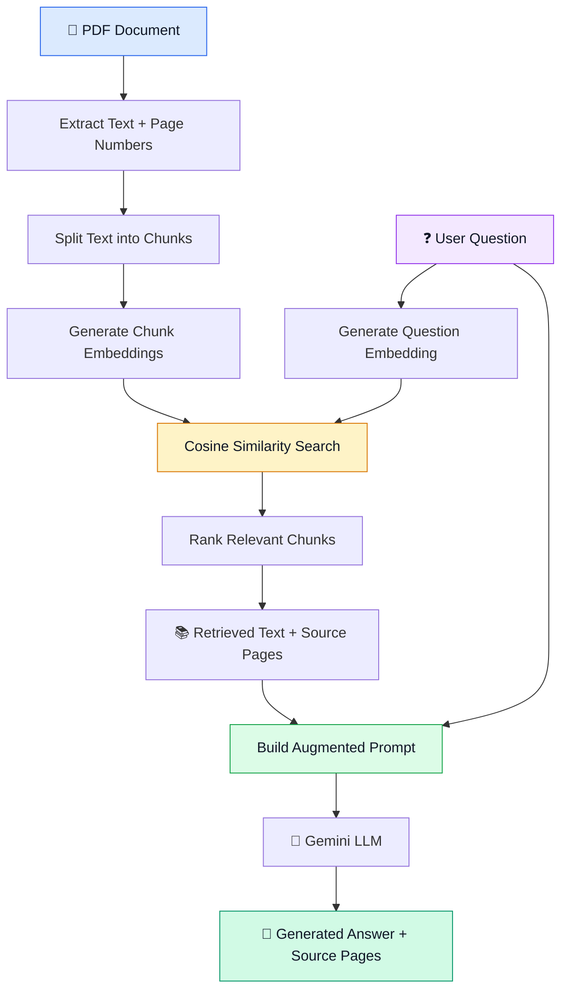

# 🔎 Micro-RAG
### A From-Scratch Semantic Search & Question-Answering System for PDFs

**Ask questions. Retrieve relevant context. Generate grounded answers.**

Micro-RAG is a Python project that implements **Retrieval-Augmented Generation (RAG)** from scratch. It takes text from a PDF document, finds passages relevant to a user's question using semantic search, and sends that context to a Large Language Model (LLM) to generate an answer with source page references.

Instead of relying entirely on the information an LLM already knows, Micro-RAG retrieves relevant information from the supplied document before generating an answer.

<p align="center">
  
  
  
  
</p>

---

## 🧠 What Is RAG?

**RAG stands for Retrieval-Augmented Generation.**

It combines two capabilities:

- **Retrieval:** Find relevant information from an external knowledge source, such as a PDF.
- **Generation:** Give that information to an LLM so it can formulate an answer using the retrieved context.

Think of RAG as an AI system that looks up the relevant parts of a document before answering questions about it.

### ❌ Without RAG vs. ✅ With RAG

| Traditional LLM | RAG-Based System |
|---|---|
| Relies on its existing knowledge and supplied prompt. | Retrieves relevant information from a document. |
| May not know the contents of a specific PDF. | Can answer questions using the PDF's retrieved content. |
| May produce unsupported answers. | Can ground answers in retrieved passages and provide source references. |

RAG improves access to document-specific information, but it does not guarantee accuracy. Retrieval quality and the model's use of context still need to be evaluated.

---

## ⚙️ How Micro-RAG Works

Micro-RAG follows the three main stages of RAG:

**RETRIEVAL → AUGMENTATION → GENERATION**



### 1. 📥 Retrieval — Finding Relevant Information

Retrieval is the process of locating document passages that are relevant to a user's question.

**Step 1: PDF text extraction**

The system uses `pypdf` to extract text page by page. It also preserves page numbers so retrieved passages can be traced back to the original document.

**Step 2: Text chunking**

Large documents are divided into smaller, overlapping chunks. Chunking makes text easier to represent, compare, and retrieve.

Each chunk retains its text and page metadata.

Example:

```python
{
    "text": "Mira discovered a brass lantern...",
    "pages": [1]
}
```

A chunk that spans multiple pages can preserve multiple page numbers.

**Step 3: Embedding generation**

An embedding model converts text into a numerical vector that represents semantic information.

For example:

```text
"Mira discovered a lantern"
              |
              v
       Embedding Model
              |
              v
   [0.12, -0.08, 0.31, ...]
```

Micro-RAG uses Google's Gemini embedding API to generate vectors for document chunks and user questions.

**Step 4: Semantic search using cosine similarity**

When a user asks a question, the system converts that question into an embedding and compares it with the document chunk embeddings.

Micro-RAG uses NumPy to calculate cosine similarity:

\[
\operatorname{similarity}(A,B)=
\frac{A\cdot B}{\|A\|\|B\|}
\]

The score measures how closely two vectors point in the same direction. Higher scores generally indicate greater semantic similarity.

Example with illustrative scores:

```text
Question: What did Mira discover in the forest?

Chunk 1  ->  0.79
Chunk 2  ->  0.61
Chunk 3  ->  0.76
Chunk 4  ->  0.34
                |
                v
       Sort by similarity
                |
                v
       Retrieve top matches
```

The system ranks the chunks and selects the highest-ranked results, with duplicate filtering to reduce repeated content.

**Important:** Similarity scores indicate semantic closeness, not proof that a chunk contains the correct answer.

### 2. 🧩 Augmentation — Combining Context with the Question

Once relevant chunks are retrieved, Micro-RAG extracts their text and combines it with the user's original question.

The retrieved source page information is retained in the context.

Example augmented prompt:

```text
INSTRUCTION:
Answer using only the context provided below.
If the answer cannot be found in the context,
say that the document does not provide the answer.

CONTEXT:

[Page 1]
Mira discovered a brass lantern hanging from an old bridge.

[Page 2]
The traveler explained that the lantern belonged
to the forest keeper.

QUESTION:
What did Mira discover in the forest?

ANSWER:
```

This process is called **augmentation** because the user's question is enriched with relevant information retrieved from the document.

The prompt construction logic is implemented in `generation.py`.

### 3. 🤖 Generation — Producing the Answer

The augmented prompt is sent to Google's Gemini generative model.

The model uses the supplied question and context to generate a natural-language answer.

Example output:

```text
=== ANSWER ===

Mira discovered a brass lantern hanging from an
old bridge in the forest.

Source Pages: [1]
```

The source page references help users locate supporting passages in the original PDF.

Micro-RAG tracks the pages associated with retrieved chunks. These references indicate where the context originated; they do not automatically guarantee that every statement in the generated answer is supported by those pages.

---

## 🧰 Technology Stack

| Technology | Purpose |
|---|---|
| Python | Core application logic |
| pypdf | PDF text extraction |
| NumPy | Numerical operations and cosine similarity |
| Google Gemini API | Text embeddings and answer generation |
| Google GenAI SDK | Python interface to Gemini |
| python-dotenv | Environment-variable configuration |
| Git and GitHub | Version control and project documentation |

The core RAG pipeline is implemented directly in Python without relying on a high-level RAG framework such as LangChain.

---

## 📁 Project Structure

```text
Micro-RAG/
│
├── main.py          # Coordinates the RAG pipeline
├── pdfread.py       # Extracts PDF text and page numbers
├── chunker.py       # Creates chunks and preserves metadata
├── embeddings.py    # Generates text embeddings
├── similarity.py    # Calculates similarity and retrieves chunks
├── generation.py    # Builds prompts and generates answers
│
├── test1.pdf        # Sample PDF for testing
├── .env             # Stores the Gemini API key locally
├── .gitignore       # Excludes secrets and generated files
└── README.md        # Project documentation
```

### What Each Module Does

**`pdfread.py` — Document ingestion**

Reads the PDF and extracts text while preserving page numbers.

**`chunker.py` — Chunk creation**

Splits extracted text into overlapping chunks and retains page metadata.

**`embeddings.py` — Vector generation**

Converts document text and user questions into numerical vectors using the Gemini embedding API.

**`similarity.py` — Semantic retrieval**

Calculates cosine similarity, ranks document chunks, and filters duplicate results.

**`generation.py` — Augmentation and generation**

Constructs a context-grounded prompt and sends it to Gemini to generate an answer.

**`main.py` — Pipeline orchestration**

Connects the modules, accepts a question, invokes retrieval and generation, and returns the answer with source information.

---

## 🚀 Getting Started

### Prerequisites

- Python installed on your system.
- A Google Gemini API key.
- An active internet connection for Gemini API requests.
- A PDF document to query.

### 1. Clone the Repository

```bash
git clone YOUR_REPOSITORY_URL
cd Micro-RAG
```

Replace `YOUR_REPOSITORY_URL` with your actual GitHub repository URL.

### 2. Install Dependencies

```bash
pip install pypdf numpy google-genai python-dotenv
```

### 3. Configure the API Key

Create a `.env` file in the project root:

```env
GEMINI_API_KEY=your_api_key_here
```

Your Python code should load the environment variable using `python-dotenv`.

**Security:** Never hardcode your API key or commit your `.env` file to GitHub. Ensure your root-level `.gitignore` contains:

```text
.env
.venv/
__pycache__/
*.pyc
```

### 4. Add a PDF Document

Place a test PDF in the project directory. Update the PDF path in `main.py` if the filename or location differs.

### 5. Run Micro-RAG

```bash
python main.py
```

### 6. Ask a Question

For example:

```text
Ask a question: What did Mira discover in the forest?
```

The system processes the question, retrieves relevant passages, constructs the augmented prompt, generates an answer, and displays the source page references.

---

## 🧪 Example Use Case

Imagine a user has a lengthy textbook and wants to understand a particular concept without manually searching through dozens of pages.

Micro-RAG processes the document and allows the user to ask a question in natural language.

```text
📄 INPUT
A textbook PDF

        |
        v

❓ QUESTION
"What caused the event described in the document?"

        |
        v

🔎 RETRIEVAL
Find relevant passages using embeddings
and cosine similarity.

        |
        v

🧩 AUGMENTATION
Combine the retrieved passages with
the user's question.

        |
        v

🤖 GENERATION
Send the augmented prompt to Gemini.

        |
        v

✅ OUTPUT
A document-grounded answer with
source page references.
```

The sample story PDF used during development is only a test document. The underlying approach can be extended to textbooks, reports, manuals, and other text-based PDFs.

---

## 📊 Current Project Status

| Component | Status |
|---|---|
| PDF text extraction | ✅ Implemented |
| Page-number metadata | ✅ Implemented |
| Overlapping chunking | ✅ Implemented |
| Embedding generation | ✅ Implemented |
| Cosine similarity search | ✅ Implemented |
| Top-k retrieval | ✅ Implemented |
| Duplicate filtering | ✅ Implemented |
| Prompt augmentation | ✅ Implemented |
| Gemini answer generation | ✅ Implemented |
| Source page tracking | ✅ Implemented |
| Relevance filtering | 🧪 Experimental; requires further evaluation |
| FastAPI backend | 🔜 Planned |
| Interactive web interface | 🔜 Planned |
| Persistent vector storage | 🔜 Planned |

The core command-line RAG pipeline is implemented. Retrieval quality and relevance filtering still need testing with different documents and questions.

---

## 🔭 Future Improvements

### 1. FastAPI Backend

Expose the existing RAG pipeline through an API so a frontend can submit questions and receive answers programmatically.

### 2. Interactive Web Interface

Allow users to upload PDFs, enter questions, and view generated answers with source references.

### 3. Improved Chunking

Use paragraph-aware or sentence-aware boundaries to reduce awkward text fragments and improve context quality.

### 4. Better Relevance Evaluation

Evaluate similarity thresholds and score distributions so the system can better distinguish answerable questions from unrelated queries.

### 5. Persistent Vector Storage

Cache embeddings to avoid regenerating every document embedding whenever the application restarts.

### 6. Better Source Attribution

Display supporting passages and source pages alongside answers to make verification easier.

### 7. Retrieval Evaluation

Create a test suite for measuring retrieval relevance, answer quality, source correctness, and behavior when information is missing.

---

## 🎯 What This Project Demonstrates

Micro-RAG explores the core mechanics of Retrieval-Augmented Generation by implementing the components individually.

Through this project, the following concepts are demonstrated:

- PDF processing and source metadata preservation.
- Text chunking and overlap.
- Embedding models and vector representations.
- Cosine similarity and semantic search.
- Ranked retrieval and duplicate filtering.
- Context construction and prompt augmentation.
- LLM-based, context-grounded answer generation.
- Source page tracking.
- Modular Python project design.

The objective is not simply to make an LLM answer questions. It is to understand how a system can retrieve information from an external document, use that information to formulate an answer, and provide references to the retrieved sources.

---

<p align="center">
  <strong>Built from scratch to understand Retrieval-Augmented Generation, one component at a time.</strong>
  <br/>
  Python • NumPy • Google Gemini
</p>
