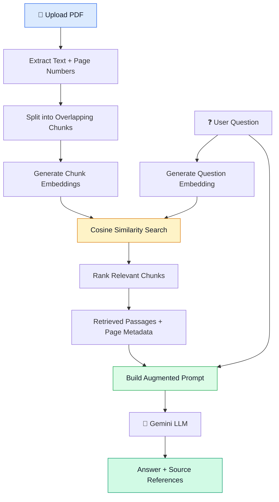

# ⚡ Micro-RAG
### A Lightweight PDF Question-Answering System Built from Scratch

**Upload a document. Ask a question. Retrieve relevant passages. Get a grounded answer.**

Micro-RAG is a Retrieval-Augmented Generation (RAG) system built using Python, NumPy, and Google's Gemini API. It allows users to upload a PDF, ask questions about its contents, and receive answers based on retrieved document passages, with source page references for verification.

I built this project to understand how RAG works internally—not just how to connect an LLM API, but how document processing, embeddings, semantic retrieval, and generation work together.

<p align="center">
  
  
  
  
</p>

---

## 📸 See It in Action

The interface supports PDF uploading, document processing, natural-language questions, generated answers, and expandable retrieved passages.

<!-- Add your actual GitHub-hosted screenshots below once uploaded. -->

| Document Processing | Question Answering |
|---|---|
| Upload a PDF and process its text into chunks. | Ask questions and receive answers grounded in the retrieved context. |

| Retrieved Sources | Grounding Test |
|---|---|
| Inspect passages, page numbers, and similarity scores. | Test how the system responds when relevant information is missing. |

---

## 🧠 What Is RAG?

**RAG stands for Retrieval-Augmented Generation.**

It combines two processes:

- **Retrieval:** Finds relevant information from an external source, such as a PDF.
- **Generation:** Uses the retrieved information as context for an LLM to formulate an answer.

A conventional LLM may not know the contents of a document supplied by a user. A RAG system retrieves relevant passages from that document and includes them in the prompt before generating an answer.

This helps ground the response in document-specific information. It does not guarantee correctness, so retrieval quality and source support still need to be evaluated.

---

## ⚙️ How Micro-RAG Works

Micro-RAG follows the core RAG pipeline:

**Retrieval → Augmentation → Generation**



### 1. 📄 PDF Extraction

The system extracts text from PDF pages using `pypdf`. Page numbers are preserved so the origin of each retrieved passage can be identified.

### 2. 🧩 Text Chunking

Large documents are divided into smaller, overlapping chunks.

Why overlap? A useful sentence or explanation might cross a chunk boundary. Overlap helps preserve some of the surrounding context.

Each chunk retains its text and page metadata:

```python
{
    "text": "Relevant text extracted from the PDF...",
    "pages": [1]
}
```

### 3. 🔢 Embedding Generation

The Gemini embedding API converts each text chunk into a numerical vector. The user's question is converted into an embedding using the same embedding model.

```text
Document chunk
      ↓
Gemini embedding model
      ↓
Numerical vector
      ↓
Stored for comparison during retrieval
```

These vectors represent semantic information in a form that can be compared mathematically.

### 4. 🔍 Semantic Search with Cosine Similarity

Micro-RAG uses NumPy to calculate cosine similarity between the question embedding and the document chunk embeddings.

\[
\operatorname{cosine}(A,B)=
\frac{A\cdot B}{\|A\|\|B\|}
\]

The scores are used to rank chunks according to their similarity to the question. The highest-ranked, non-duplicate chunks are selected as context.

A higher similarity score indicates greater vector similarity, but it does not guarantee that a passage contains the answer.

### 5. 🧩 Prompt Augmentation

The retrieved passages are combined with the original question to create an augmented prompt.

The prompt instructs the language model to answer using the supplied context and to acknowledge when the information is unavailable.

### 6. 🤖 Answer Generation

The augmented prompt is sent to Google's Gemini generative model. The model produces a natural-language answer based on the retrieved passages.

### 7. 📚 Source Tracking and Grounding

The interface displays retrieved passages with source page numbers and similarity scores. It also includes a grounding test to check whether the system declines questions that lack relevant document information.

Source references make it easier to inspect the retrieved evidence, although they do not automatically guarantee that every generated claim is supported.

---

## ✨ Features

- **PDF upload and processing** — supply a document through the web interface.
- **PDF text extraction** — extract text with `pypdf`.
- **Overlapping text chunking** — divide content into manageable pieces while preserving context.
- **Page metadata** — retain page references for retrieved chunks.
- **Gemini embeddings** — represent text and questions as numerical vectors.
- **Semantic retrieval** — rank chunks using NumPy cosine similarity.
- **Duplicate filtering** — reduce repeated passages among retrieved results.
- **Context-aware generation** — send retrieved information to Gemini as an augmented prompt.
- **Expandable source passages** — inspect retrieved text, page numbers, and similarity scores.
- **Grounding test** — test how the application behaves when a question is unsupported by the document.

---

## 🧰 Technology Stack

| Technology | Purpose |
|---|---|
| Python | Core RAG pipeline |
| pypdf | PDF text extraction |
| NumPy | Vector operations and cosine similarity |
| Google Gemini API | Embedding generation and answer generation |
| Google GenAI SDK | Python integration with Gemini |
| python-dotenv | Environment-variable configuration |
| HTML, CSS, JavaScript | Web interface, if used in the current frontend |
| Git and GitHub | Version control and project documentation |

The retrieval logic is implemented directly rather than delegated to a high-level RAG framework such as LangChain.

---

## 📁 Project Structure

The Python pipeline is organized into separate modules:

```text
Micro-RAG/
│
├── main.py          # Coordinates the RAG workflow
├── pdfread.py       # Extracts text and page numbers
├── chunker.py       # Creates overlapping chunks
├── embeddings.py    # Generates embedding vectors
├── similarity.py    # Cosine similarity and retrieval
├── generation.py    # Prompt construction and answer generation
├── .env             # Local API key configuration
├── .gitignore       # Excludes secrets and generated files
└── README.md        # Project documentation
```

The web interface may have additional frontend or backend files depending on your latest repository version.

---

## 🚀 Getting Started

### Prerequisites

- Python 3.10 or a compatible version.
- A Google Gemini API key.
- Internet access for Gemini API requests.
- A PDF document to query.

### 1. Clone the repository

```bash
git clone YOUR_REPOSITORY_URL
cd YOUR_REPOSITORY_DIRECTORY
```

Replace the placeholders with your actual GitHub repository URL and directory name.

### 2. Install the Python dependencies

```bash
pip install pypdf numpy google-genai python-dotenv
```

Install any additional packages required by your current web application.

### 3. Configure your API key

Create a `.env` file in the project root:

```env
GEMINI_API_KEY=your_api_key_here
```

Load the variable through `python-dotenv` and keep the API key out of source code.

**Security:** Never commit your real API key to GitHub. Ensure `.env` is listed in `.gitignore`.

### 4. Run the application

Use the startup command for your current application entry point. For the original command-line pipeline, this is:

```bash
python main.py
```

If you are running the web interface, follow the startup instructions for the frontend and backend in your repository.

---

## 🧪 Example

Suppose a user uploads a report containing information about a research project.

They ask:

> How many chunks were created from the report?

Micro-RAG embeds the question, compares it with the document embeddings, retrieves relevant passages, and constructs a prompt containing the retrieved context.

The LLM then generates an answer from that context. The interface displays the answer and lets the user inspect the retrieved passages and their source pages.

The example demonstrates how semantic retrieval and generation work together to answer questions about a document.

---

## 🛠️ Challenges and Lessons Learned

Building Micro-RAG involved more than calling an embedding API and sending a prompt to an LLM.

Some of the key challenges included:

- **Connecting separate Python modules:** Ensuring that extraction, chunking, embeddings, retrieval, and generation passed the correct data to each other.
- **Managing changing data structures:** Preserving the relationship between chunk text, similarity scores, and page metadata.
- **Debugging vector comparisons:** Verifying that each chunk had its own embedding and that cosine similarity was calculated against the correct vectors.
- **Preserving source information:** Carrying page numbers through chunking and retrieval instead of losing them during processing.
- **Handling unsupported questions:** Testing how the system behaves when the document does not contain relevant information.
- **Managing API configuration:** Keeping API credentials in environment variables and debugging network or configuration errors.

One important lesson was that **a high similarity score does not necessarily mean a passage contains the correct answer**. Retrieval quality, context construction, and answer grounding all matter.

---

## 📊 Current Status

| Component | Status |
|---|---|
| PDF upload and processing interface | ✅ Demonstrated |
| PDF text extraction | ✅ Implemented |
| Chunking and page metadata | ✅ Implemented |
| Embedding generation | ✅ Implemented |
| Cosine similarity retrieval | ✅ Implemented |
| Prompt augmentation | ✅ Implemented |
| Gemini answer generation | ✅ Implemented |
| Source passage display | ✅ Demonstrated |
| Grounding test | ✅ Demonstrated |
| Relevance evaluation across varied documents | 🔧 Ongoing |
| Persistent vector storage | 🔜 Planned |
| Broader retrieval evaluation | 🔜 Planned |

---

## 🔭 Future Improvements

- **Improve relevance filtering:** Evaluate thresholds against a diverse set of answerable and unanswerable questions.
- **Improve chunking:** Experiment with sentence-aware and paragraph-aware boundaries.
- **Cache embeddings:** Avoid regenerating document embeddings unnecessarily.
- **Evaluate retrieval quality:** Measure whether the correct passages appear among the retrieved results.
- **Improve source attribution:** Make it easier to verify generated claims against supporting passages.
- **Strengthen document handling:** Test scanned PDFs, tables, and information distributed across multiple pages.

---

## 🎯 Why I Built Micro-RAG

I built Micro-RAG to understand RAG as a system of connected components instead of treating it as a black box.

Working through extraction, chunking, embeddings, cosine similarity, retrieval, and prompt augmentation helped me understand where the retrieved context comes from and how it influences an LLM's answer.

The biggest takeaway was that **good answers depend not only on the language model, but also on the quality of the information retrieved for it**.

Micro-RAG is an ongoing learning project, and the next step is to improve retrieval reliability and continue developing the application.

---

<p align="center">
  <strong>Built to learn Retrieval-Augmented Generation by implementing its core components.</strong>
  <br/>
  Python · NumPy · Google Gemini
</p>
